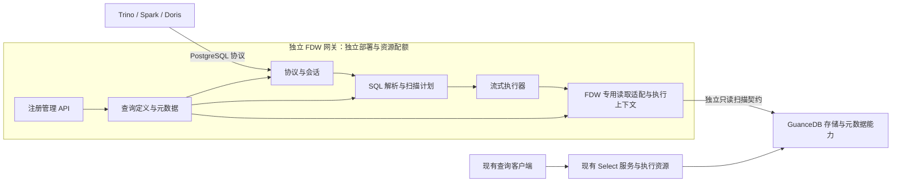

# GuanceDB 独立 FDW 网关设计方案

- 日期：2026-10-21
- 状态：设计草案，尚未实现或完成运行验证
- 产品形态：独立工程、独立进程提供 PostgreSQL 协议，通过 FDW 专用只读扫描契约访问 GuanceDB，与现有 Select 查询链路分离
- 范围：只读、不物化、不缓存完整结果

## 1. 目标与设计边界

将已注册的 DQL 查询发布为有固定名称、列和类型的关系表，使 Trino、Spark、Doris 等查询引擎能够通过现有 PostgreSQL Connector 或 JDBC 访问，并在外层完成关联分析。

产品可命名为 **GuanceDB FDW Gateway**。这里的“独立 FDW 网关”指兼容 PostgreSQL 读取接口的外部数据源网关：网关自行提供协议、元数据、SQL 处理和流式执行能力，不采用真实 PostgreSQL 前端加 FDW 扩展的部署方式。

**网关必须与现有 Select 查询链路分离。** 本文的 Select 指 GuanceDB 现有 Select 查询服务及其在线查询链路，不是 SQL 的 `SELECT` 关键字。网关具有独立的工程、构建入口、进程、部署、配置、发布和资源管理边界；FDW 请求不得通过现有 Select 服务代理、执行或兜底。

设计边界如下：

- 独立工程与构建产物，独立部署、独立进程运行，不作为现有 Select 的路由、模块或启动模式。
- FDW 与 Select 分别管理入口、调度队列、并发配额、执行上下文、游标和取消状态。
- 通过独立的只读扫描契约访问 GuanceDB；复用公共能力时使用版本化依赖，不依赖 Select 服务进程或其内部接口。
- 只读访问 GuanceDB，不提供写回路径。
- 保存查询注册定义、Schema、权限和版本等元数据。
- 执行结果只保留有界内存批次，不创建结果表、持久结果缓存或湖表文件。
- 第一版支持单表流式扫描，将通用 JOIN、聚合、排序等操作留在外部查询引擎。
- PostgreSQL 兼容范围以受测客户端、连接器版本及配置为准，不承诺完整 PostgreSQL 数据库能力。
- 当前仅进行设计，不修改业务实现或部署环境。

## 2. 总体架构

网关自身采用单进程、按职责划分模块的结构。第一版不拆分为多个网关服务；这个单进程独立于现有 Select 进程部署。



上图是目标边界：两条链路可以共享经授权的底层数据和存储能力，但 FDW 数据请求不经过 Select。独立扫描契约是否已有可用实现、需要暴露哪些读取能力，属于实施前的待确认项，图中不假定该接口已经存在。

| 模块 | 主要职责 |
| --- | --- |
| 协议与会话 | 认证、消息处理、参数绑定、Portal、结果编码、取消 |
| 查询目录 | 注册查询、Schema、权限、版本及 PostgreSQL 元数据 |
| SQL 处理 | 解析 AST、校验支持范围、生成扫描计划、判断下推 |
| 流式执行器 | 本地过滤、投影、Offset、Limit、背压、预算 |
| GuanceDB 适配 | 生成 DQL 或扫描请求，通过 FDW 专用读取契约处理后端分页、状态、错误及取消 |
| 注册管理 | 校验、发布、禁用、授权和诊断 |

协议编解码和 SQL 解析优先复用成熟组件。扫描计划采用固定的单表执行路径，第一版不建设通用的成本优化器。

### 2.1 与现有 Select 的职责边界

| 维度 | 独立 FDW 网关 | 现有 Select |
| --- | --- | --- |
| 入口与调用路径 | PostgreSQL 读取入口、独立注册管理入口、专用扫描契约 | 保持现有在线查询入口与调用路径 |
| 工程与交付 | 独立构建产物、配置、版本、部署、升级及回滚 | 保持既有交付和发布周期 |
| 调度与配额 | 独立队列、并发额度、内存预算、超时和限流 | 保持在线查询的队列及预留资源 |
| 执行状态 | 自行持有查询计划、Portal、分页令牌及取消状态 | 不承载 FDW 会话和执行上下文 |
| 管理数据 | 独立注册目录、版本及元数据存储 | 不要求复用 Select 会话或运行配置 |
| 可观测性 | 独立工作负载标识、指标、日志及审计归属 | 保留现有指标口径和查询诊断 |
| 故障与运维 | 单独启动、停止、扩缩容和排障 | FDW 故障不触发 Select 重启或发布 |

允许复用无状态的 DQL 解析、类型转换、协议定义和权限校验等公共库，以及经授权的存储、数据和元数据契约。公共库通过版本化依赖复用；若复用查询执行内核，其执行状态、调度和资源必须由 FDW 自己创建和管理，不能带入 Select 的服务级全局状态。

现有 Select 私有接口、调度器、任务队列、游标注册表和会话状态不作为 FDW 的依赖。独立读取路径不可用时明确报错，不自动转发到 Select；注册校验也必须检查数据源绑定是否符合这一边界。

共享底层存储仍可能产生 I/O、连接和带宽争用。进程分离本身不能保证无影响，需要为 FDW 设置独立工作负载预算，并通过与 Select 并行运行的压力验证确认影响。具体资源隔离能力和验收阈值待实际后端评估后确定。

## 3. PostgreSQL 协议兼容

### 3.1 兼容范围

独立网关需要承担完整的消息状态管理，不能仅实现握手和返回行。

| 能力 | 首版要求 |
| --- | --- |
| 建立连接 | TLS、Startup、认证、ParameterStatus、BackendKeyData |
| Simple Query | 连接检查、受支持会话命令、业务查询 |
| Extended Query | Parse、Bind、Describe、Execute、Close、Flush、Sync |
| 参数 | 有类型的参数绑定，处理空值和类型不确定错误 |
| 返回结果 | RowDescription、DataRow、CommandComplete |
| 分批读取 | Portal 保存执行位置，支持暂停和继续 |
| 异常恢复 | ErrorResponse 后按协议恢复，正确报告会话事务状态 |
| 取消与关闭 | CancelRequest、Terminate、连接断开后的清理 |

处理约定：

1. `Parse` 解析 SQL、检查支持范围，不执行 DQL。
2. `Describe` 从查询目录返回参数及结果元数据，不扫描数据。
3. `Bind` 绑定类型化参数并创建 Portal。
4. 第一次 `Execute` 启动后端读取。
5. 达到本次返回行数上限且查询未结束时，返回 `PortalSuspended`。
6. 整个 SQL 正常结束后，才返回 `CommandComplete`。
7. Extended Query 发生错误后，按协议处理后续消息和 `Sync`，恢复到正确的会话状态。

上述消息及恢复行为以 [PostgreSQL 协议消息流程](https://www.postgresql.org/docs/current/protocol-flow.html)为依据。

### 3.2 类型与结果编码

首版覆盖连接器常用的 `boolean`、整数、浮点、`text` 和 `timestamptz`，同时验证文本及二进制传输。

| 类型领域 | 约定 |
| --- | --- |
| 整数 | 精确解析，溢出报错，不经过浮点中转 |
| 浮点 | 明确 NaN、无穷值等特殊值的处理 |
| 时间 | 固定原始单位、时区和精度转换规则 |
| 文本 | 不静默截断或修改内容 |
| 空值 | 区分缺失字段、NULL 和空字符串，按注册定义转换 |
| 未支持类型 | 注册时拒绝，避免执行中途才发现无法编码 |

即使结果为零行，网关也必须提供完整且稳定的 Schema。

### 3.3 会话与事务

事务命令用于管理只读会话和游标生命周期。第一版支持短读取事务，不承诺 GuanceDB 上的多语句事务快照。

需要明确维护空闲、事务中、事务失败等会话状态，以及事务结束时 Portal 和后端读取上下文的清理规则。所有状态归 FDW 网关持有，不能借用 Select 的事务、会话或游标。

## 4. PostgreSQL 元数据兼容

元数据兼容作为单独的交付项。网关维护虚拟目录，覆盖受测驱动需要的操作：

- 数据库、Schema、表、列及权限发现。
- `pg_catalog`、`information_schema` 的必要查询。
- 类型 OID、列序号、可空性和类型修饰。
- `current_database()`、`current_schema()`、版本信息等必要函数。
- 连接器产生的零行探测 SQL。

元数据查询不能只靠匹配完整 SQL 字符串返回固定响应。应解析查询结构，再执行已支持的元数据操作；对超出范围的查询明确报错。

没有主键或索引时可以返回真实的空集合，未知统计信息不能伪装成零行。

元数据、版本信息和业务 Schema 来自同一份查询目录。版本字段用于明确的驱动兼容基线，产品文档同时标明网关身份和兼容范围。

获取列信息、预编译描述、`LIMIT 0` 和普通 `EXPLAIN` 均不得触发数据扫描。

## 5. 业务 SQL 支持范围

首版收敛到单表流式扫描。

| SQL 能力 | 首版行为 |
| --- | --- |
| 单表读取、列投影、别名 | 支持 |
| 参数、基本类型转换 | 支持明确列出的范围 |
| 比较、IN、空值判断、布尔组合 | 支持有类型的表达式计算 |
| 简单子查询包装 | 支持连接器需要的形式，并保留运算顺序 |
| LIMIT、OFFSET | 在正确的执行位置处理 |
| JOIN、外层聚合、窗口、去重、通用排序 | 交给外部查询引擎 |
| 写入、DDL、存储过程 | 不提供 |

收到 SQL 后先完成整体校验，再执行。超出能力范围时返回明确的“不支持”错误，不能忽略表达式，也不能假设调用方收到错误后会自动重新规划。

简单子查询包装按关系树保留运算顺序，只在能够证明等价时合并，不能越过内部 Limit、聚合或 Top N 改写外层条件。

原始 DQL 自身可以包含聚合、排序或 Top N；这些操作属于注册查询的内部语义。

## 6. DQL 查询注册

### 6.1 注册对象

每个注册版本包含以下内容：

| 内容 | 契约 |
| --- | --- |
| 身份 | query_id、版本、发布名称 |
| 数据源 | FDW 专用只读扫描绑定、工作空间、凭据引用及工作负载资源域 |
| 查询 | 受控扫描模板，或完整原始 DQL |
| Schema | 固定列顺序、类型、可空性、字段映射 |
| 时间 | 时间列、单位、范围要求及边界 |
| 能力 | 可下推字段、操作符、分页和取消能力 |
| 策略 | 超时、并发、扫描及内存预算 |
| 权限 | 可读取主体及状态 |

凭据仅保存受控引用，不发布到普通表元数据或客户端可见的查询说明中。

### 6.2 两种注册模式

| 模式 | 查询定义 | 下推策略 |
| --- | --- | --- |
| 受控扫描模板 | 使用结构化的数据源、字段和过滤定义生成 DQL | 支持经过验证的下推 |
| 完整 DQL | 保留完整原始查询 | 网关在结果之上执行支持的过滤和投影 |

如果没有可靠、可复用的 DQL 解析器，第一版只对受控模板实施下推。完整 DQL 保持原样，避免通过正则或字符串替换修改语义。

例如：

- `logs.checkout_errors_v3`：明细扫描模板，基础条件为错误状态，允许继续下推服务名和事件时间。
- `metrics.service_error_counts_1h_v1`：完整 DQL，统计最近一小时各服务错误数量；外层对计数的过滤作用于聚合结果。

第二张表的“一小时”属于表定义，必须在名称、说明或元数据中明确体现。

### 6.3 生命周期与版本

注册流程为：校验、受限预览、发布、授权。校验和预览均使用 FDW 独立读取路径，检查数据源、配额及工作负载归属，不能借用 Select 执行预览。

查询发布后不原地修改。新定义发布新版本；一次扫描固定定义版本、参数、Schema 和绝对时间范围。

预览用于检查结构，运行时仍逐页检查字段和类型。少量样本不能证明所有历史数据符合 Schema，也不能据此推导唯一或非空约束。

管理 API 提供注册、验证、发布、禁用、授权及版本查看。普通数据读取统一走 PostgreSQL 协议。

## 7. 条件下推与本地执行

### 7.1 扫描计划

独立网关必须自己执行未下推的受支持条件。

| 计划内容 | 用途 |
| --- | --- |
| 后端查询定义 | 固定原始关系 |
| 下推条件 | 交给 GuanceDB 执行 |
| 本地条件 | 网关逐行执行 |
| 必需字段 | 输出和本地计算共同需要的字段 |
| 输出投影 | 最终列及顺序 |
| Offset、Limit | 在过滤之后处理 |
| 时间及预算 | 限制整次扫描 |
| 分页配置 | 确定续读和结束规则 |

执行顺序为：

```text
GuanceDB 读取
    → 字段转换
    → 本地过滤
    → 输出投影
    → Offset
    → Limit
```

普通 SQL 参数由协议层完成类型绑定，执行计划取得实际值。不能将输入直接拼入 DQL；后端没有参数接口时，应使用受控模板和类型化的字面量序列化。

### 7.2 下推原则

1. **等价条件可以完整下推。** 例如直接映射字段的整数比较、语义一致的字符串等值、明确精度的时间范围。
2. **粗粒度条件只能返回候选超集。** 例如时间精度不同，可以扩大后端范围，再由网关精确重检。
3. **无法证明安全时保留本地计算。** 特别是空值、缺失字段、大小写、排序规则、浮点特殊值和派生字段。

对于 AND，可以拆分其中独立且安全的条件。对于 OR、NOT 及其他组合，不能随意移出部分表达式；应保持整体在本地执行，或只下推经过证明的必要条件并保留完整重检。

### 7.3 投影、过滤与 Limit

查询包含时间、服务名和一个不能下推的文本条件时：

- 时间和服务名可以在验证后交给 GuanceDB。
- 文本条件由网关执行。
- 即使文本列不出现在最终投影中，也必须读取它。
- `LIMIT 100` 作用于本地过滤之后。
- 后端分页大小不改变 SQL 的结果上限。

不能先让后端只返回 100 条候选记录，否则本地过滤可能使网关遗漏后续符合条件的记录。

### 7.4 完整 DQL 的语义边界

对于“先取全局 Top 10，再过滤服务”的注册 DQL，服务条件必须保持在 Top 10 之后，不能移入原始数据扫描。

会改变聚合输入、窗口、分组或 Top N 成员的参数，不自动解释为普通输出列过滤。需要在注册定义中明确其输入语义，并单独验证调用方式。

## 8. 时间范围契约

支持两种明确模式：

| 模式 | 行为 |
| --- | --- |
| 调用方提供范围 | SQL 必须包含可识别的有限时间条件，缺失时拒绝扫描 |
| 表定义自带范围 | 例如“最近一小时”，执行时一次性计算绝对起止时间 |

不能在缺少条件时默默套用默认窗口。

内部统一明确时区、时间单位和边界，例如半开区间 `[start, end)`。参数在执行阶段绑定，同一扫描期间不重新计算相对时间。

如果源时间精度高于发布的时间类型，可以保留原始整数时间列供精确比较。无法证明转换等价时，扩大后端候选范围并在本地重检。

对聚合桶、窗口或其他派生时间列，默认不将结果时间过滤转换成原始输入范围。

## 9. 流式分页

### 9.1 两层读取状态

| 层次 | 管理内容 |
| --- | --- |
| PostgreSQL Portal | 客户端交付进度、参数、事务及暂停状态 |
| FDW 后端分页上下文 | 独立读取路径上的扫描位置、分页令牌及可能存在的读取快照，与 Select 游标隔离 |

Portal 暂停和恢复不会自动赋予后端一致性快照。

一个活动扫描至少保存：

- 定义版本及已绑定参数。
- 后端执行或分页上下文。
- 当前有界页缓冲。
- 本地过滤及投影计划。
- 已输出行数和 Offset、Limit 状态。
- 截止时间、空闲时间和取消状态。

### 9.2 正常读取流程

1. 客户端执行 Portal。
2. 网关按需获取后端第一页。
3. 在页大小上限内接收并检查响应。
4. 转换字段并执行本地条件。
5. 向客户端发送本次允许的结果行。
6. Portal 暂停时保留当前进度。
7. 后续 Execute 继续消费当前页，再读取下一页。
8. 正常结束、取消或失败后统一清理。

第一版使用一个活动页缓冲，不预取下一页。客户端变慢时停止拉取后端新页，内存同时受单行、单页、单扫描和进程预算限制。

第一版采用单路后端扫描，不将任意 DQL 按时间切片后拼接。聚合、去重和全局排序需要单独的分片及合并规则。

### 9.3 分页适配契约

每个后端适配配置必须明确：

- 正常结束的判定。
- 空页是否仍可能有后续数据。
- 续读令牌的真实含义。
- 重复请求是否安全。
- 游标有效期。
- 是否绑定一致读取视图。

Guance 公开查询接口中的分页参数仅作为现有语义的参考，不代表网关将复用 Select 入口。FDW 专用扫描契约需要单独确认分页组合、结束条件和保证，不能因公开接口存在某个字段就推定独立路径已经具备快照或安全重试能力。

不能仅凭本页行数判断结束，也不能默认重试可能已经推进的服务端游标。进展检查必须遵守具体游标契约，不能通用地假定令牌每页都会变化。

游标过期或读取状态不确定时，使整次扫描失败。不得从头执行后按行数跳过，以此冒充原游标续读。

### 9.4 完整性与一致性

“完整结果”表示后端扫描按约定正常结束，且没有未声明的采样、截断或权限缩减；它不自动表示某个时间点的一致快照。

| 场景 | 首版保证 |
| --- | --- |
| 查询定义、参数及 Schema | 同一次扫描固定 |
| 数据读取视图 | 取决于 GuanceDB 后端能力 |
| 失败后重新执行 | 可能得到不同结果 |
| 跨表、跨数据源关联 | 不承诺共同快照 |
| 跨连接恢复游标 | 不提供 |

后端没有快照能力时，固定时间范围和网关执行 ID 都不能补出快照保证。

HTTP 成功状态不代表结果完整，适配器需要检查业务状态和告警。用于精确查询的采样、截断、权限缩减等情况应明确失败，不能静默作为完整外表返回。

错误发生前已经发送的行无法撤回。最终 SQL 成功状态到来前，调用方应将前序行视为未完成结果，并在最终失败时丢弃相应输出。

## 10. 背压、预算与取消

预算至少覆盖：

| 预算 | 处理方式 |
| --- | --- |
| 单行、单页大小 | 超限时失败，不静默截断 |
| 单扫描、进程内存 | 有界缓冲，并发准入控制 |
| 扫描总时间 | 首次执行固定截止时间，不因每次 Fetch 重新续期 |
| 客户端空闲时间 | 到期关闭扫描并回收资源 |
| 扫描行数、字节数 | 达到资源上限时报错 |
| 租户、实例并发 | 使用 FDW 自己的队列及额度，在后端执行前进行准入控制 |
| 底层工作负载预算 | FDW 扫描按独立工作负载计量和限制，不消耗 Select 的预留查询额度 |

FDW 与 Select 的子配额分别管理，底层总预算仍需满足共享存储容量限制。FDW 过载时应在自身队列和预算内等待或拒绝，不能借用 Select 队列或通过重试切换到 Select。

SQL 自身的 Limit 正常满足时，可以成功结束并提前关闭后端读取；资源预算耗尽必须以错误结束。

取消路径为：

```text
客户端取消
    → 网关会话收到取消
    → 停止网络读取
    → 取消或关闭后端上下文
    → 释放 Portal、缓冲和并发额度
```

如果后端不支持真正取消，只能保证网关停止读取和释放本地资源，后端计算仍依赖其超时机制终止。需要在能力配置中明确记录这一区别。

正常关闭、异常退出、事务回滚、连接断开、提前满足 Limit 等路径，都进入同一套幂等资源回收流程。取消标识和执行归属需要可验证，FDW 取消只作用于本链路的执行上下文，不能误取消 Select 查询。

## 11. 查询引擎接入配置

连接器配置是网关交付的一部分。

| 产品 | 首版接入策略 |
| --- | --- |
| Trino | 保留基础过滤、投影和受支持的 Limit；关闭聚合、JOIN、Top N、复杂表达式下推 |
| Spark | 保留基础谓词下推；关闭未支持的聚合、排序相关及采样下推；先使用单分区读取 |
| pgJDBC | 固定受测版本，验证元数据、参数、二进制模式及游标行为 |

Trino JDBC 基础实现提供以下相关开关，但仍需针对实际发行版本验证：

- `aggregation-pushdown.enabled`
- `join-pushdown.enabled`
- `topn-pushdown.enabled`
- `complex-expression-pushdown.enabled`

Spark 同样提供相关下推配置。其 JDBC 分区边界用于计算分区跨度，不等同于业务过滤条件，不能替代显式时间范围。

pgJDBC 游标读取需要满足自动提交、fetch size 和结果集模式等要求。验收时必须确认客户端没有退回完整结果缓冲。

兼容性以“版本、驱动、配置、通过的行为”发布，逐步扩大覆盖范围。未通过实际请求及结果验证的组合，不列为已支持。

## 12. 部署、持久化与多副本

### 12.1 首版单实例

首版建议：

- 提供独立可执行程序或容器镜像，以及独立配置、管理端口、数据端口和启动入口。
- 启动、健康检查、发布和回滚不依赖 Select 进程；后端读取能力检查针对 FDW 专用契约。
- 查询注册、版本和授权使用本地事务型元数据存储，例如 SQLite。
- 执行状态、Portal 和页缓冲保存在内存。
- 结果不落盘；网关重启后，活动查询由调用方重新执行。
- 管理端口与数据读取端口分开授权。
- 停机先停止接收新扫描，在宽限期后取消剩余扫描。

网关升级不要求同步调整现有 Select 的入口、响应格式或发布版本。若需要补充底层只读扫描能力，应按独立契约实施和评审，不能通过向现有 Select 添加 FDW 模式来替代独立网关。

### 12.2 多副本扩展

扩展为多副本时，需要共享或同步已发布元数据，并解决取消请求路由。

PostgreSQL 取消请求使用一条新连接，可能落到其他网关节点。因此需要通过会话标识定位原执行节点并转发取消，不能仅依赖长连接保持在原节点。

第一版不提供活动 Portal 的跨节点恢复。节点故障后，由调用方重新执行整个查询，并接受已声明的后端一致性语义。

## 13. 诊断与可观测性

诊断信息应能展示：

- FDW 独立工作负载标识、读取路径和资源配额归属。
- 注册定义版本及后端能力配置。
- 实际绝对时间范围。
- 下推条件、本地条件及保留本地执行的原因。
- 必需字段及最终投影。
- 分页方式及执行状态。
- 后端读取行数、输出行数和页数。
- 缓冲峰值、执行时间、超时及取消结果。
- 错误阶段和可关联的请求标识。

普通诊断输出不暴露凭据或敏感查询字面量。普通 EXPLAIN 只展示计划，不执行数据读取。

FDW 指标、日志和审计具有独立归属。共享底层存储的观测信息应保留工作负载标签，以区分 FDW 与 Select 的资源消耗，并能核对 FDW 请求实际经过的读取路径。

## 14. 实施与验收计划

| 阶段 | 必须验证的行为 |
| --- | --- |
| 独立性与隔离 | 独立构建、启动、升级、回滚和故障恢复；读取经过专用契约；队列、配额、游标及取消状态与 Select 分离 |
| 协议兼容 | JDBC 表列发现、零行结果、参数绑定、重复预编译、二进制传输、错误后恢复 |
| 可靠读取 | 相同时间戳、空页、游标过期、丢失响应、慢客户端、大字段、取消及资源回收 |
| 引擎接入 | Trino、Spark 实际请求落在支持范围内，过滤结果正确，外层 JOIN 和聚合正确 |

重点回归场景：

1. 元数据操作、零行探测和普通 EXPLAIN 不触发后端扫描。
2. 未下推的受支持条件被完整执行，并读取了必要字段。
3. 外层 Limit 作用于本地过滤之后。
4. 聚合和 Top N 注册查询的语义不因条件下推改变。
5. 多页相同时间戳记录不因分页方式遗漏。
6. 网络错误和重试不悄悄跳页或重复输出。
7. 采样、截断、权限缩减及类型变化不会被静默接受。
8. 超时、取消和连接关闭后无遗留活动扫描。
9. 慢客户端、大字段和大结果下，内存保持在设定预算内。
10. 定义更新不改变已运行扫描的 Schema、参数和定义版本。
11. FDW 请求、预览和重试均经过专用读取路径，路径不可用时明确失败。
12. FDW 过载、超时、取消、重启及版本回滚均限制在自身运行和资源边界内。
13. FDW 与 Select 并行运行时，按工作负载分别核对队列、额度、执行上下文和取消归属。
14. 通过混合压力场景比较 Select 的基线与并行运行时延迟、错误率及资源消耗，并按事先约定的阈值验收共享底层存储的影响。

运行验证阶段按既有工程约定，在 OrbStack 中部署网关、测试后端及相关查询引擎，并保留独立 Select 对照链路，完成完整行为及隔离验证。独立性验收需要调用路径和资源归属证据，不能仅依据新增端口或进程名称判断通过。

## 15. 待确认事项与当前状态

实施前需要针对实际 GuanceDB 环境确认：

| 待确认能力 | 对设计的影响 |
| --- | --- |
| FDW 专用只读扫描契约及执行边界 | 确认如何绕开现有 Select 服务并建立独立执行上下文，是正式数据路径验收的前置条件 |
| 后端工作负载隔离及共享存储预算 | 决定 FDW 与 Select 的资源配额、容量边界和混合压力验收阈值 |
| 完整结果读取与采样、截断状态 | 决定哪些查询可发布为精确关系表 |
| 续读及结束语义 | 决定分页状态机和结束判定 |
| 游标一致性、有效期 | 决定读取保证及过期处理 |
| 重复请求的安全性 | 决定是否允许自动重试 |
| 后端取消与截止时间 | 决定取消承诺及资源终止方式 |
| 具体类型、时间精度和缺失字段行为 | 决定 Schema 转换及安全下推范围 |

首版范围固定为：与现有 Select 在工程、部署、调用路径、执行状态和资源配额上分离的独立服务、PostgreSQL 只读兼容、版本化 DQL 注册、单表扫描计划、本地剩余条件执行、有界流式分页，以及受测的 Trino、Spark 接入配置。

本文记录的是设计决策及验收计划。尚未编写业务实现、连接实际 GuanceDB 环境或执行运行验证。

## 16. 参考资料

- [PostgreSQL 协议消息流程与取消](https://www.postgresql.org/docs/current/protocol-flow.html)
- [PostgreSQL 协议消息格式](https://www.postgresql.org/docs/current/protocol-message-formats.html)
- [pgJDBC 查询与游标读取](https://jdbc.postgresql.org/documentation/query/)
- [Trino PostgreSQL Connector](https://trino.io/docs/current/connector/postgresql.html)
- [Trino JDBC 下推配置实现](https://github.com/trinodb/trino/blob/master/plugin/trino-base-jdbc/src/main/java/io/trino/plugin/jdbc/JdbcMetadataConfig.java)
- [Spark JDBC 数据源](https://spark.apache.org/docs/latest/sql-data-sources-jdbc.html)
- [Guance DQL 查询 API](https://docs.guance.com/en/open-api/query-data/query-data-v1/)：仅参考现有查询及分页语义，不作为复用现有 Select 调用路径的依据。

以上链接包含随版本变化的文档或源码。进入实施阶段后，需要锁定实际采用的网关组件、驱动、查询引擎及 GuanceDB 版本，并以相应版本重新验证兼容范围。
