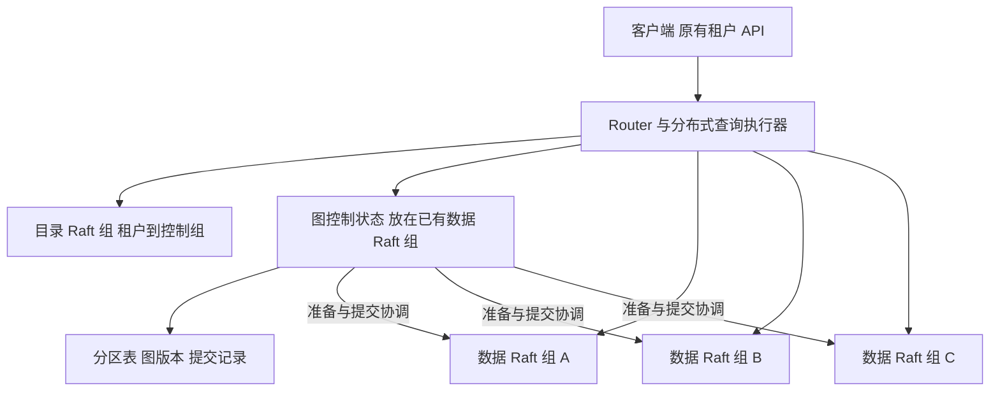

# 大图跨机器分片设计

状态：2026-11-09 开发分支实现中，基线 `28bb6df`。已实现分区内核、跨组提交、受预算约束的查询、维护窗口转换、在线分区搬迁及旧页回收；范围和验证见[实施说明](large-graph-sharding-implementation.zh-CN.md)。备份恢复、WAL 接入、完整生命周期和超级节点仍在后续阶段，不能将本分支视为已完成生产交付。

建议保留租户作为权限、配置和生命周期边界，在租户内部增加可独立迁移的图分区，由多个数据 Raft 组承载。每张图保留一个复制的控制状态，负责统一图版本、原子提交决策和分区位置；数据与查询执行分散到多个组。第一阶段优先解决单图容量和查询扩展，保留每图有序提交，不承诺单图写入吞吐随机器数线性增长。

## 1. 当前边界与目标

当前一个租户对应一张逻辑图，没有独立的 `graph_id`。本方案沿用这个模型，不为分片增加面向用户的多图 API。

| 当前实现 | 对大图分片的影响 |
| --- | --- |
| [Placement](../internal/sharding/types.go) 是 `tenant_id → shard_id`，Router 将请求代理到一个组 | 增加数据组只能分散不同租户 |
| [Graph](../internal/graph/graph.go) 持有整图实体、边、身份与邻接索引 | 将请求路由拆开仍不能消除整图加载和整图校验 |
| [Manifest 与 TenantStore](../internal/storage/tenant.go) 以租户为发布、版本和写锁边界 | 需要分区存储与图级发布两个不同的边界 |
| [本机 ShardedMap](../internal/graph/sharded_map.go) 有 256 桶；[边索引分桶](../internal/storage/index_shard.go) 使用另一套规则 | 这些桶不是分布式所有权，不能直接视为 Raft 分区 |
| [租户迁移](sharding.zh-CN.md) 复制完整租户并暂停该租户服务 | 可以复用分块传输和恢复机制，需要新增分区范围的快照、增量与所有权 |

目标包括：单租户图的数据超出单机容量；跨组关系、反向查询和多跳查询保持正确；提交成功后的写后读、幂等及 `expected_version` 继续成立；扩缩容只搬动选定分区。普通单机、单组和小租户保留原路径。

## 2. 两级路由与部署



第一层仍由目录组保存 `tenant → home_group`，分片图的 home group 承载图控制状态。第二层由图控制状态保存 `partition → data_group`。目录组不参与每笔图提交，避免把所有大图写入汇聚到全局目录 Leader。

图控制状态是某个已有 Raft 组中的一份状态，不为每张图或每个逻辑桶创建独立 Raft 组。同一数据组可承载多张图的多个分区。首版延续现有一个 Raft 组一个服务实例的部署方式，多个实例可以运行在一台机器上；多组共用一个进程的 Multi-Raft 调度另行处理。

每个数据组默认三个独立副本，副本放到不同故障域，并将不同组的 Leader 分散到多台机器。推荐从六台等规格机器、六个数据组举例：各组三副本轮转放置，让每台承载三个组副本，六个 Leader 均匀分布。均匀情况下，每台保存约半份整图的基础数据。

三副本逻辑数据量为 D 时，仅复制后的基础数据量就约为 3D，还要另留索引、WAL、迁移和旧读视图空间。三台机器部署三副本时，每台仍须保存接近一份整图数据，增加组数主要分散 Leader 工作，不能增加可用磁盘容量。M 台等规格机器的理论可用基础容量约为 `M / 3 × 单机容量`；因此六台约为两台机器的容量，实际更低。三副本放在同一机器不能抵御宿主机故障。

## 3. 分区与数据归属

### 3.1 稳定的虚拟分区

为分片图引入独立、带格式版本的路由 hash 空间。以区分大小写的规范编码键计算 SHA-256，初始按首字节预划分为 256 个 hash 范围。256 是建议初始值，不是验收后的容量参数。分区数量与物理组数量解耦，新增组通过搬迁范围扩容，不改变 `hash(key) % 机器数`。

分区 ID 是稳定身份，保存 hash 范围、所属组和 ownership epoch。范围过大时可继续按下一位拆成两个子范围，原范围退役；拆分通过同样的迁移和原子布局切换流程发布。路由格式、分区代次与现有逻辑 `data_hash` 的 256 桶相互独立。

### 3.2 常规顶点与边

| 数据 | 默认位置 | 契约 |
| --- | --- | --- |
| 实体及本地字段索引 | `hash(canonical_entity_id)` 对应分区 | 使用规范 ID，不按输入别名路由 |
| 边完整记录及出邻接 | 起点实体所在分区 | 保留现有边规范化身份；出边与起点就近 |
| 入邻接引用 | 终点实体所在分区 | 保存边规范 ID、起点、类型和逻辑位置引用，指向唯一边主记录 |
| 来源身份、IdentityKey、unique 字段、实体与边别名目录 | `hash(命名空间及规范约束键)` 对应分区 | 是事务中的权威约束数据，不是可滞后的普通二级索引 |
| schema、来源规则、图 generation 和全图提交版本 | 图控制组 | 每次事务与查询固定对应版本 |

边的逻辑位置引用保存分区 ID，不固化机器地址。组迁移后通过分区表找到新位置。按边别名或仅按边 ID 查询时，先查别名或边定位目录，再访问主记录。

跨组边 `A → B` 通常涉及 A 分区的边主记录和出邻接、B 分区的入邻接，必要时还涉及身份或约束分区；它们必须属于同一笔图提交。业务上只存在一条边，逻辑摘要和边计数只统计主记录。

### 3.3 超级节点

普通的顶点 hash 不能拆散一个顶点的全部邻接。分页只能限制一次读取，不能解决其邻接集中在单机的问题。

邻接目录从一开始就允许引用多个不可变 segment。普通节点只有一个与顶点同位置的 segment；高出度或高入度节点按边规范 ID 的 hash 范围拆分 segment，再将不同 segment 的完整出边记录或入邻接引用放到其他分区。segment 目录属于固定图版本，并记录范围、分区和页根；读取按目录批量访问。拆分边主记录时，同笔事务更新边定位目录和受影响引用。

出邻接和入邻接可以独立拆分。顶点属性仍只有一个权威位置，按端点约束的唯一记录也不拆成多个独立计数器。segment 分裂、迁移与目录切换使用普通事务和分区迁移协议，不靠异步双写。

第一阶段可先验证普通节点路径；宣称支持超级节点容量扩展前，必须完成 segment 跨组实现与对应验收。单个顶点的高频属性更新仍受一个权威位置及每图提交协调限制。

## 4. 控制状态与存储边界

图控制状态至少保存以下内容：

```text
GraphDescriptor
  tenant_id, generation, mode, format_version
  layout_revision, schema_revision, published_version
  partition_map_root, graph_manifest_root

PartitionPlacement
  partition_id, hash_range, data_group_id, ownership_epoch, state

GraphManifest
  generation, graph_version, schema_root
  partition_id -> immutable_partition_root
  logical_hash_state_root

TransactionRecord
  txn_id, idempotency_identity, request_digest
  generation, base_version, schema_revision
  durable_input_refs, participant_set, prepared_root_refs
  state, result
```

分区表和图 manifest 都可使用不可变页与写时复制，控制日志记录变化的根和有界描述，不反复复制全部数据。控制状态按图分布在多个 home group 中。首版限制单次事务字节数、参与组数、准备空间和受理队列，超限返回明确错误或走现有分批导入；不能悄悄把一笔原子提交拆成独立成功的子提交。

数据组需要新增分区级读写、快照及校验入口。存储键增加明确的图 generation 与 partition 作用域，禁止把内部图分区伪装成外部租户：租户生命周期、配额、认证和备份仍是整张图的边界。

不能直接将不完整分区交给 `graph.FromSnapshot`，因为它要求关系端点存在于本地图。应保留完整图的现有校验路径，将分片路径需要的规范化和规则校验复用为基于固定读视图的操作；远端端点、身份目录和约束记录通过批量读取参与校验，不以伪造实体绕过检查。

## 5. 跨组原子提交

### 5.1 第一阶段的并发选择

同一张图一次推进一个发布事务；参与组并行执行数据准备，不同图并行推进。这样延续现有每图有序写入和标量版本，避免同时引入分布式写锁、全局时间戳和并发事务冲突控制。

事务协调器由图控制组 Leader 驱动，故障后由新 Leader 根据复制状态恢复。网络 RPC 和耗时计算发生在 Raft apply 之外；apply 只执行有界、确定性的状态转换。请求正文先以有界分块在数据组多数派持久化，控制日志保存内容摘要与引用，不能把整图或全部变更再次复制到控制日志。规范化后的参与组可能变化，需要在准备前固定最终参与集合。每图事务占用从 BEGIN 持续到完成或权威 ABORT，故障不能使两个协调器各自发布下一版。

这个选择能分散存储、索引构建、准备计算和查询工作；单图提交频率仍有串行上限。后续只有实测证明提交协调已成为瓶颈，才增加不相交写集合的并发准备和有序发布。

### 5.2 协议与可见性

1. **受理**：固定 generation、schema 和基准版本 V，解析全局身份及别名。输入已经多数派落盘后，控制组复制 `BEGIN`，绑定幂等身份和输入摘要；WAL 模式此时可返回 `202`，仅表示可恢复受理。
2. **验证与准备**：在 V 的统一视图上验证完整变更集，包括同批次新增端点、最终身份及关系约束。各参与组多数派持久化准备记录、不可变新分区根和约束变更，返回绑定 txn、epoch、基准根及摘要的准备结果。准备数据不进入任何公开读根。
3. **提交决定与发布**：所有参与者准备成功后，控制组在同一 Raft 状态转换中记录不可撤销的 `COMMIT`、结果及 V+1 的图 manifest 根。这个转换是图级可见点。无内容变化的事务沿用现有 skipped/version 契约。
4. **完成**：参与者依据权威提交决定完成本地发布和准备记录收尾。同步提交在参与组已具备可查询状态后返回成功；WAL 状态到此才成为 `committed`。决定已提交但响应超时，客户端得到的是结果未知，按原身份查状态或重试，不是回滚成功。

读请求只使用某个已发布 GraphManifest 引用的分区根。即使某参与者尚未收到收尾通知，它也只能在核实控制组提交决定后服务新根，否则等待或返回可重试错误。不能仅比较各组 Raft index：不同 Raft 组的日志位置没有全图版本的含义。

`expected_version` 在控制组决定事务资格时验证。幂等身份的作用域与保留语义沿用现有 direct/WAL 契约，原身份绑定原事务和结果，跨 Router、跨 Leader、跨迁移不重复增加图版本。相同身份配不同内容返回冲突。

控制组和数据组的 Raft 快照都必须包含未决事务状态及其保护的对象引用；数据组还须保留准备数据、未收尾提交根及迁移增量。日志压缩、快照安装和副本替换不能只复制当前可见分区根，否则会丢失已受理输入或已准备事务的恢复依据。

### 5.3 约束与失败恢复

IdentityKey、来源身份和 unique 字段由其权威约束分区校验；端点的关系基数在对应端点约束记录上校验。`one_to_many` 限制终点入关系，`many_to_one` 限制起点出关系，`one_to_one` 检查两端。实体删除、merge/split 和 schema 修改必须考虑所有关联分区，不能只检查本组。全图 schema 变更先在固定 V 上跨分区验证，全部通过才发布。

| 故障点 | 恢复规则 |
| --- | --- |
| BEGIN 前失败 | 未受理的暂存块可按有界保留期清理 |
| 部分参与者已准备，控制 Leader 故障 | 新 Leader读取复制事务状态，继续准备或复制 ABORT；参与者不能自行按超时回滚 |
| COMMIT 已复制，部分参与者未完成 | 新 Leader及参与者补完；不允许改成 ABORT |
| 控制组失去多数派 | 停止新提交及新强一致读的版本获取；已固定根的查询在所需数据组仍可服务时可继续 |
| 某参与组失去多数派 | 影响需要该组的新操作；其他组上的已固定查询可继续。每图单事务阶段中，一个未决提交也可能阻塞本图后续写入 |
| 旧 Leader或旧 Router 延迟请求 | 控制状态前置条件及参与组 generation、partition epoch、txn 身份共同隔离 |

这是建立在各组 Raft 之上的图级两阶段提交。单组一致性和安全读索引继续由现有 Raft 层提供；跨组决定和原子可见性由上述协议提供。Raft 的安全读取需要确认当前领导权，不能把 Leader 缓存当成读屏障，见 [etcd Raft 的线性一致读说明](https://github.com/etcd-io/raft#features)及 [Raft 论文第 8 节](https://raft.github.io/raft.pdf)。

## 6. 统一读视图和分布式查询

Router 内的查询执行器通过图控制组读屏障获取已发布版本及 manifest 根，再在整次请求中固定：

```text
generation + graph_version + schema_root + graph_manifest_root
```

分区位置可随迁移更新；读取的逻辑根不能变化。控制组提供的内部读凭证与外部请求参数分离，数据组校验租户、generation、根及权限，不能直接信任客户端提交的根或位置。普通读取取得开始时的已提交图快照；`min_version=N` 要求选定版本至少为 N。`allow_stale` 即使选择较旧版本，也仍须选择完整已发布快照，不能任意拼接各组的旧状态。

| 操作 | 执行方式 |
| --- | --- |
| 按实体 ID 获取 | 规范化引用后路由到一个实体分区，按固定根读取 |
| 邻居查询 | 读取固定版本的出/入邻接目录，批量获取 segment；按目标分区批量获取实体及必要的边属性 |
| 多跳、影响分析、最短路 | 执行器维护全局 frontier、visited 和深度；每一轮按组批量 expand，合并后再推进下一轮 |
| 属性过滤、match | 下推过滤和投影到候选分区；无路由条件时扫描全部相关分区，统一合并 |
| 排序与分页 | 使用相同比较器及身份 tie-breaker，合并分区有序结果；不是逐组套用原 LIMIT 再直接拼接 |
| 聚合 | count/sum/min/max 使用分区部分结果；avg 合并 sum/count；distinct、分组上限和不具可合并状态的操作单独做全局计算或明确拒绝 |

复用现有 `EntityBatchLookup`、邻边访问和游标能力，但不能仅给旧 Lookup 套 RPC：旧 planner 的全图枚举、身份索引和物化 fallback 仍可能拉取整图。分片模式必须有显式执行路径，禁止在 Router、控制组或任一数据节点回退到整图加载。

查询预算统一覆盖已扫描/访问数量、RPC 次数、并发、返回字节、frontier 内存和截止时间；预算先分配给各组，执行器回收未使用配额，不能让每组独立消耗一份完整全局预算。超级节点展开必须分页，执行器不能先拉完全部邻边再截断。

请求所需的任一分区缺失、落后或出错时，返回明确失败。流式查询通过既有终态协议报告错误；预算截断保留明确的 truncated 状态。不能将失联分片当成空集并返回完整成功。

分页游标绑定 generation、图 manifest 根、查询条件、全局排序位置和必要的分区续读位置。不可变根通过有界 snapshot pin 保留；pin 登记、续期和释放须与控制状态及各组 GC 水位协调，Router 内存不是唯一持有者。到期后明确返回游标失效，不切换到最新版本继续。租户禁用、purge 或 restore 仍校验当前生命周期状态并撤销不再有效的读凭证。组迁移后，若新组保留同一逻辑根，可从新位置继续读取。

## 7. 扩缩容与在线迁移

迁移单位变为图内分区，记录持久化在图控制组；目录组仍负责物理组注册和 home group 定位。选择目标时结合磁盘字节、写入、查询 CPU、Leader 分布及迁移预留空间，不继续以租户数量作为大图负载指标。首版由显式操作选择迁移分区，暂不加入自动均衡控制器。

```text
COPY_BASE → CATCH_UP → FENCE_SOURCE → SWITCH → RETIRE_SOURCE
```

1. 在已提交版本 V0 固定源分区根，多数派持久化迁移状态和增量保留水位。先固定增量保留再开始基线复制，防止复制窗口漏变更。
2. 复用有界分块、摘要、磁盘暂存和断点恢复机制，将该分区的对象复制到目标。源继续服务，按已提交事务顺序重放 V0 之后的分区增量；未决准备数据不作为已提交变更导出。
3. 追赶接近完成后，控制组阻止新事务触及该分区，结束相关未决事务，源组多数派持久化写入 fence，确定最终边界。其他分区的读取继续；首版每图写入调度可能出现短暂停顿。
4. 目标补齐最终增量并多数派确认可服务的根、约束记录、旧读根和必要幂等状态。控制组原子切换位置及 epoch；目标凭已提交切换决定激活。图逻辑版本和 `data_hash` 不因纯搬迁增加或改变，布局 revision 单独增加。
5. 源拒绝旧 epoch 的新操作；只有受 pin 保护的旧根读取可以继续，或转到已复制同一根的目标。等待旧读根、备份与恢复引用释放后再清理。

切换前可取消，但必须用新的持久化 epoch 恢复源，不能降低 epoch 或直接解除旧 fence。切换后只向前恢复，不能直接把路由改回源。迁移状态、输入摘要和目标安装位置共同支持协调器、源和目标分别切主后的重试。增量赶不上写入时显示积压并暂停/取消迁移，或进入显式维护窗口，不承诺无界负载下固定停顿时间。

drain 必须检查图控制状态、图分区、邻接 segment、迁移记录和保留引用；仍承载图控制状态的组不能仅因实体分区搬空就注销。home group 迁移需要额外转移控制所有权和隔离代次，首版应阻止其自动迁移，不复用“图数据搬空即安全”的判断。

## 8. 逻辑摘要、备份与生命周期

保留现有 [`sha256-shards-v2` 逻辑内容摘要](content-hash-v2.md)的规范编码与算法。它的逻辑 hash 桶不随物理分区变化：每个逻辑叶在固定 V 上只统计一次，入邻接、定位目录和副本不参与逻辑边计数。参与者并行生成变化叶，分布式摘要任务以分页保存的规范键和叶摘要流式计算受影响逻辑桶；图控制组仅合并四类各 256 个桶摘要并保存对应状态根。物理迁移不改逻辑叶。

兼容摘要必须给出与单机逐项计算一致的结果，且不能把各物理分区的 SHA256 再拼接冒充旧摘要。现有桶内算法是对有序叶摘要串做 SHA256，不是可按任意子树合并的 Merkle hash：单项修改仍可能重算整个逻辑桶，均匀分布下工作量随该类记录数的约 1/256 增长。流式计算限制内存，但不消除这个 CPU 和 IO 上限；摘要工作计入提交预算，不能宣称小更新恒定成本。若兼容摘要的增量更新成本在实测中不可接受，另行设计带新算法标识的协议；不得沿用旧前缀返回不同含义。

备份先固定一个已发布 GraphManifest，复制所有引用的分区根、schema、必要控制元数据和幂等身份。只有全部对象验证后才发布完整备份清单；缺一个组就是未完成备份。恢复先在新 generation 中安装和校验全部分区，再原子发布新图描述；禁止逐组暴露部分恢复结果。

租户 disable、purge、配额和任务以图控制状态协调，下发到全部分区；purge 先隔离 generation，再逐组清理并可恢复重试。clone、restore-drill、merge/split、来源清理等操作也须通过完整的分片事务或后台任务实现。未完成适配的操作在分片模式明确报能力错误，不能绕回旧的整租户单组接口。

GC 必须保护当前图根、准备事务、未收尾 COMMIT、有效 snapshot pin、备份和迁移引用。事务状态与幂等记录只有在全部参与者确认及既有保留契约满足后才能收缩，不能因普通超时丢弃未决提交。

## 9. 旧租户转换与协议兼容

增加明确的 `single_group` 与 `partitioned` 图模式，普通租户仍走现有代理及提交路径。所有相关 Router、控制组和数据组具备新能力并完成协议检查后，才能启用分片图；旧程序必须拒绝新布局，不能按旧 Manifest 打开。

第一阶段转换采用维护窗口：排空已受理写入和任务、冻结租户、固定原图 V，流式构建分区与全局约束目录；验证对象完整性、端点、身份、关系基数及逻辑摘要；全部目标准备好后由持久化转换状态驱动切换。图 generation 可为隔离旧路径而提升，旧游标随之明确失效，图逻辑版本 V 及受理身份继续保持。切换前可丢弃暂存并恢复旧图，切换后按新模式向前恢复。

该过程需要增加新模式的持久化切换协议，不是直接改目录 JSON。转换期所有入口返回明确维护状态，源组保留 epoch/generation 隔离记录，防止旧 Router 绕过转换状态写入旧图。数据量大的转换可能需要较长窗口；在线转换作为后续独立能力，不能套用已有整租户迁移的完成承诺。

分片模式启用后不能直接降级到旧二进制；需要经显式合并导出、完整校验和布局转换恢复为旧程序支持的单组数据。只有能在目标机器容纳整图时才允许合并。

## 10. 实施范围与验收

| 阶段 | 范围 | 完成条件 |
| --- | --- | --- |
| 1 分区内核 | 图描述、分区存储、固定根读取和单分区准备 | 写入与恢复不加载全图；旧单组行为保持 |
| 2 跨组正确性 | 图级提交、身份与约束、跨组边及反向邻接 | 原子可见、幂等、故障恢复、统一版本通过 |
| 3 分布式查询 | 批量点查、邻居、遍历、排序分页与聚合 | 与单组固定版本结果及预算语义一致 |
| 4 运维交付 | 旧图转换、分区迁移、备份恢复、生命周期、诊断 | 故障与恢复矩阵通过，才开放分片图使用 |
| 5 热点扩展 | 超级节点 segment 跨组、范围再分裂 | 高度节点在单机容量之外仍能正确读写与迁移 |

模块按现有职责扩展：`internal/sharding` 管理描述与两级路由；`internal/ha` 承载复制的控制状态、分区 ownership 和事务状态转换；`internal/storage` 实现分区根、准备数据、pin 和传输；`internal/query` 负责分布式算子与全局预算；`internal/httpapi` 保持外部协议并增加明确的模式和能力检查。按职责增加文件，避免把新协议堆进当前 Router 或 Application 大文件。

运行验收默认在 OrbStack 的多组、多副本环境中进行；实际跨主机容量和网络代价需要独立环境验证，单宿主容器不能证明跨机器性能。至少覆盖：

- 跨组创建、删除、重连关系，merge/split、身份冲突、unique 和关系基数；与单组相同变更集逐版本比较结果及逻辑摘要。
- BEGIN、PREPARE、COMMIT、参与者收尾、响应发送等各窗口的进程崩溃与切主；已受理不丢、已提交不撤销、重试不重复发布。
- 并发提交、分页、多跳读取与持续写入，验证每次请求只看到一个图版本；pin 到期及生命周期变化正确失效。
- 一个组失去多数派、控制组失去多数派、目录失联、缓存旧路由、旧 Leader 延迟到达，以及跨租户伪造分区和读根。
- 迁移期间持续写入，分别中断源、目标和协调器；校验追赶、取消、切换隔离、恢复与 GC 无漏数据。
- 备份部分失败、恢复中断、purge 重试和磁盘接近满；准备空间和旧读视图不能耗尽磁盘而无背压。
- 图规模逐级超过单机内存，记录各数据节点、Router 和控制组峰值内存；单实体更新、有限邻居查询及备份不能隐含整图物化。
- 比较不同组数、跨组边比例、跳数和度分布下的吞吐、p95/p99、网络字节、准备积压及迁移停顿；不给出未经测量的线性扩展承诺。

设计与实现分别维护：本页描述完整目标，当前已实现的接口、限制和运行证据见[实施说明](large-graph-sharding-implementation.zh-CN.md)。参数阈值、单图最大分区数及容量上限仍需通过规模验收确定。
